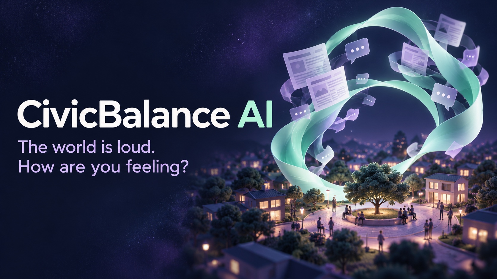
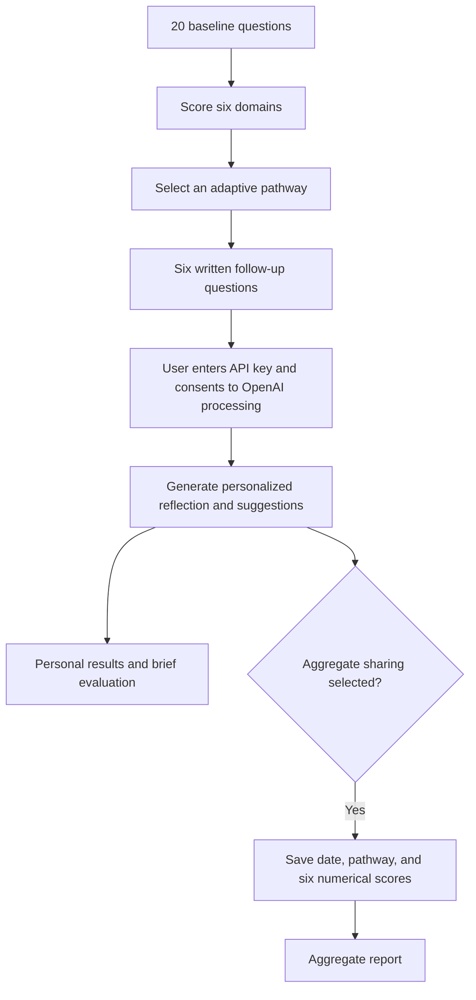

# CivicBalance AI

**The world is loud. How are you feeling?**



CivicBalance AI is a nonpartisan web app that helps people reflect on how
political news affects their well-being, relationships, and sense of civic
agency. It combines a 26-question adaptive questionnaire with personalized
AI reflections and practical suggestions for healthier news habits.

Created for the **Congressional App Challenge**, the project was inspired by
personal experiences and those of people nearby with social media and current
events: there is so much happening that staying informed can feel overwhelming.

> CivicBalance AI is an exploratory self-reflection prototype. Its scores are
> descriptive, not clinically validated measurements or a medical diagnosis.

## What the app does

- Asks **20 multiple-choice baseline questions** across six domains.
- Selects **one of three pathways**, then asks **six written follow-up questions**.
- Shows six domain scores, an AI-generated reflection, three personalized
  suggestions, and a short three-bullet evaluation.
- Lets users choose separately whether to contribute numerical scores to an
  aggregate report.
- Provides a token-protected report with response counts, domain averages, and
  pathway distribution. Individual written answers are excluded.

There are no account-registration or party-affiliation fields. The AI prompt
requires ideological neutrality and instructs the model to base suggestions
on the supplied answers without inferring political affiliation or diagnoses.

## How it works



### Scoring and adaptive pathways

| Domain | Questions | What it explores |
| --- | --- | --- |
| A: News Fatigue | 1–4 | News exposure, checking urges, overload, and physical stress |
| B: Compassion Fatigue | 5–8 | Emotional exhaustion, numbness, and difficulty disengaging |
| C: Affective Polarization | 9–12 | Reactions to opposing views and relationship strain |
| D: Motivated Reasoning | 13–15 | Evidence checking, defensiveness, and all-or-nothing thinking |
| E: Spiral of Silence | 16–17 | Self-censorship and perceived dominance of extreme voices |
| F: Political Cynicism | 18–20 | Institutional trust, perceived civic impact, and futility |

Each selected option carries 0–4 points. Questions 13 and 18 have reverse-scored
options. Each domain is normalized independently:

```text
domain score = 100 × sum of selected option scores / (4 × questions in domain)
```

| Pathway | Follow-up focus | Routing priority |
| --- | --- | --- |
| 1 | Sensory Overload & Emotional Exhaustion | Mean of A and B |
| 2 | Social Polarization & Digital Isolation | Mean of C and E |
| 3 | Cognitive Rigidity & Civic Helplessness | Mean of D and F |

The highest priority selects the pathway. Ties prefer the pair with the highest
individual domain score, then the lowest pathway number. Routing is
reproducible and requires no AI call. Higher scores indicate more of the
reported experience; the app does not apply clinical severity cutoffs.

## Technology

| Component | Implementation |
| --- | --- |
| Backend | Python and Flask |
| Frontend | HTML, CSS, and vanilla JavaScript |
| AI generation | OpenAI Responses API with structured JSON output |
| Default model | `gpt-4o-mini`, configurable through `OPENAI_MODEL` |
| HTTPS certificates | Python's configured trust store plus `certifi` |
| Aggregate storage | A local tab-separated text file |
| Tests | Python `unittest` and Node.js's built-in test runner |

The current app uses Flask templates and local file storage. React/Next.js,
a database, and district-level research metrics in the design document are
proposed architecture, not features of this version.

## Run locally

Requirements: Python 3 with `pip` and `venv` (tested with Python 3.13), a modern
browser, and an internet connection for AI generation. The user needs an
OpenAI API key with access to the configured model. API usage is billed to that
key's OpenAI account. No key is needed to run the automated tests.

From the project folder containing `server.py`, run:

```sh
python3 -m venv .venv
source .venv/bin/activate
python3 -m pip install -r requirements.txt
python3 server.py
```

These shell commands are for macOS/Linux. Open
[http://127.0.0.1:5050/](http://127.0.0.1:5050/) in your browser; opening
`templates/index.html` directly does not run the backend.

To choose another port, stop the server with **Ctrl+C** and run:

```sh
PORT=5051 python3 server.py
```

Then open [http://127.0.0.1:5051/](http://127.0.0.1:5051/). Port 5000 can be
occupied by macOS AirPlay.

### Complete a reflection

1. Answer all 20 baseline questions and select **Submit**.
2. Answer the six follow-up questions in the selected pathway.
3. Enter your OpenAI API key in the password field and agree to send your
   answers to OpenAI for personalized generation.
4. Optionally select aggregate sharing, then select **View my reflection**.

All 26 answers are required. The key field clears when generation begins and
must be filled again to retry. Written answers remain on the page after a
failed request; refreshing the page does not restore them.

### Configuration

Set environment variables before starting the server:

| Variable | Default | Purpose |
| --- | --- | --- |
| `PORT` | `5050` | Local server port |
| `HOST` | `127.0.0.1` | Network address to bind |
| `OPENAI_MODEL` | `gpt-4o-mini` | Model used for reflection generation |
| `FLASK_SECRET_KEY` | Random value on each startup | Flask session signing secret |
| `REPORT_ACCESS_TOKEN` | `showme` | Staff report access token for the local demo |

The supplied server is intended for local development. For deployment, use
HTTPS, a production server, a persistent signing secret, and a private staff
report token. Restarting without a persistent signing secret invalidates
existing questionnaire sessions.

## Aggregate report

Open [http://127.0.0.1:5050/report](http://127.0.0.1:5050/report), or `/report`
at your chosen port. Enter the configured staff token; `showme` is the default
local demo token.

After successful AI generation, opted-in results append to
`constituent_sentiment.txt`. The app creates this file if it does not exist.
The report shows the response count, average domain scores, and distribution
across the three follow-up pathways.

`MIN_REPORT_SAMPLE` is a Python constant in `server.py`, currently `1` for the
local demo. It controls the minimum report size and suppresses pathway counts
below that threshold. Choose an appropriate larger threshold for community
use. Existing rows may include pathways assigned by an earlier version.

Respondents are self-selected. These aggregates are exploratory and do not
establish representative district sentiment or population-level health findings.

## Privacy and data handling

- **API key:** Sent to the backend in `X-OpenAI-Key` and used to authorize one
  OpenAI request per generation attempt. The app does not save the key in
  files, cookies, browser storage, reports, or application logs.
- **Written answers:** Sent to OpenAI only after explicit consent. They and
  generated reflections are processed transiently and are not saved by the app.
  Users should avoid entering names or contact details.
- **Survey session:** Baseline answer indices, six scores, and the selected
  pathway temporarily occupy Flask's signed session cookie. Signed cookies
  are not encrypted. The session clears after successful completion.
- **Aggregate record:** Contains only a UTC date, the selected pathway, and
  six numerical scores. Sharing is optional and separate from AI consent.
- **Provider processing:** Requests use `store: false`; this does not establish
  zero provider retention. OpenAI's applicable data policies still apply.

The page checks the app's health endpoint before sending the key. API responses
use `Cache-Control: no-store`, and failed AI requests do not add aggregate rows.

## Project structure

```text
server.py                   # Routes, scoring, pathways, and report
recommendations.py          # OpenAI request, TLS, and output validation
questions.txt               # Baseline questions and option scores
pathways.txt                # Three sets of six follow-up questions
templates/                  # Questionnaire and report HTML
static/                     # Styling and browser logic
docs/images/                # Cover image
requirements.txt            # Flask and certifi dependencies
tests/                      # Automated checks and isolated browser harness
```

The questionnaire and pathways are loaded from `questions.txt` and
`pathways.txt`. The web app does not read the Word documents at runtime.

## Testing

Run these commands from the folder containing `server.py`:

```sh
python3 -m unittest discover -s tests -v
node --test tests/test_api_response.js
```

Node.js is needed only for the JavaScript tests. Automated checks cover routing,
reverse scoring, ties, all 26 answers, consent, key handling, TLS verification,
API failures and retry, personal results, report opt-in/opt-out, and small-group
suppression. Tests mock the provider and use temporary aggregate files.

For an isolated browser demo with synthetic answers and a fake provider:

```sh
python3 tests/serve_browser_test.py --empty-health-once
```

Open [http://127.0.0.1:8765/](http://127.0.0.1:8765/). The first reflection attempt
simulates an empty server response; re-enter the dummy key
`sk-browser-test-not-a-real-key-12345` to retry. This harness does not contact
OpenAI or modify the real report. Live AI generation requires the user's own
key entered in the main app.

## Troubleshooting

| Symptom | What to do |
| --- | --- |
| `python: command not found` | Use `python3` in the commands above. |
| Port already in use or an empty response on port 5000 | Choose port 5050 or another available port and open that same address. |
| HTTPS certificate verification error | Activate the app's environment, run `python3 -m pip install --upgrade certifi`, then restart the server. |
| Key field becomes empty after an error | Re-enter the key to retry; clearing it is intentional. |
| Initial questionnaire/session error after restarting | Start a fresh questionnaire. |

## Project documents and scope

The design is based on **Congressional Project.docx** and **Diagnostic Assessment
Framework (The 26-Question Model).docx**. They define the research motivation,
six baseline sections, and three adaptive pathways.

The specification also proposes CLI, AFS, and CAQ indices and broader research
outputs. This web app currently displays the six domain scores documented above;
it does not claim to calculate those three indices or a validated clinical
signal. AI reflections and optional suggestions support self-awareness, not
proof that the assessment measures psychological health accurately.

## Future improvements

- Explore locally running AI so users would not need their own API keys.
- Add optional private check-ins to compare experiences over time.
- Make follow-ups more responsive to individual answers and turn suggestions
  into small weekly action plans.
- Add multilingual support and improve accessibility through user testing.
- Work with users and researchers to evaluate reliability and potential bias.
- Improve deployment, staff access controls, and aggregate storage.
